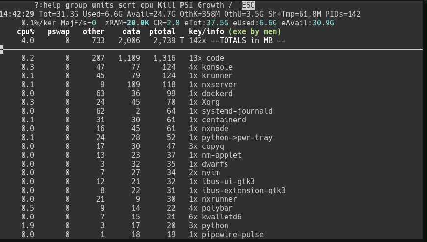

# pmemstat - Proportional Memory Status



`pmemstat` shows detailed **proportional** memory use of **Linux** processes by digesting `/proc/{PID}/smaps` and `/proc/{PID}/smaps_rollup`. Proportional memory (PSS) splits the cost of shared memory among its sharers instead of counting it repeatedly as `top` does, and excludes uninstantiated virtual memory.

Without `-o` it is much faster but less detailed; `-o` adds classes such as SysV shared memory (a few slow seconds at startup, fast on later loops; `o` toggles it in window mode). Grouping rolls up all processes of one feature (e.g. a browser), looping reveals growth that may be a leak, and segregating memory by type makes leaks easier to identify.

## Quick Start
Requires **Python 3.10 or later**.
* **Install:** `pipx install pmemstat`
* **Run:** `pmemstat` — elevates via `sudo` to show *all* processes
* **No root?** `pmemstat -U` — user-only, degraded view (below)
* **Upgrade:** `pipx upgrade pmemstat`
* **Options:** `pmemstat -h`; inside the program, `?` lists the keys.

## The `-U` (Unprivileged) View
The default run is root. `-U`/`--user` is a **degraded, partial view**, marked `--user` in the header:
* You see only your own processes (`PIDs=shown/total` shows the gap).
* `Oth` cannot split into `OthK`/`OthU`; it silently absorbs every unreadable process.
* Growth history is root-only, so growth is measured from this run's start (`z` unavailable).
* Kill mode reaches only your own processes.

Use `-U` only when you cannot elevate; a failed elevation exits with a clear message. Persistent flags go in `PMEMSTAT_ARGS` (e.g. `export PMEMSTAT_ARGS='--psi --loop 3'`); the command line still wins.

## Highlights
* Proportional PSS accounting — shared pages split fairly
* Memory-type breakdown — shared, swap, stack, text, data
* Proportional swap per grouping
* Group by exe, command, pid or cgroup v2
* Growth/leak monitoring with cross-run, per-boot history
* zRAM-aware effective RAM (`eTot`/`eUsed`/`eAvail`)
* System pressure (PSI) in the header
* Full-screen window — inline search, themes, kill mode

## How It Compares
Reach for `top`/`ps`/`htop` for a quick overview; `pmemstat` focuses on accurate proportional memory and the sources of growth.
* `top` / `htop` — familiar, but no PSS or memory-type breakdown.
* `smem` — PSS, but no cgroup grouping, growth history or PSI.
* `systemd-cgtop` — per-cgroup, but no proportional memory or leak tracking.

For per-mapped-file attribution use `smem -m` or `pmap`.

## Usage
`pmemstat -h` lists every option. Notable ones:
* `-g {exe,cmd,pid,cgroup,cgroupCharge}` — grouping
* `-P` — PSI header table and per-cgroup `memPSI%`
* `-a SECS` — CPU averaging window (5–90)
* `-k KB` — minimum change to re-show a looping row; gates the growth annotation
* `--growth-style`, `--growth-top` — growth annotation (`G`, `p` in window mode)
* `--no-growth-history`, `--dont-save-growth-history`, `PMEMSTAT_NO_HISTORY`
* `-W` — one-shot report instead of the window
* `pids` — pids or executable names to limit the report

## Grouping by cgroup v2
`-g cgroup` (or `g` in window mode) groups by the cgroup v2 path from `/proc/<pid>/cgroup`. Rows show the leaf unit name (e.g. `foo.service`); a trailing `+` marks a cgroup that also has descendants listed separately. If the leaf name matches none of its member executables (common with launcher app scopes), the dominant executable labels the row; the full path stays searchable with `/`.

Two views: `kcharge` (`memory.current`, what `memory.max`/the OOM killer act on) and `footprt` (a stable resident working-set proxy that ignores reclaimable cache/slab but counts swap). `ptotal` is kept as a left-hand reference because PSS is not what `systemd-cgtop`/`docker stats` report.

Kernel columns decompose the charge (slices sum to the total): `anon`, `cache`, `kmem`, `swap` (`footprt` only), `oK` (remainder, normally `sock`), then the row total `footprt`/`kcharge`. Accounting is hierarchical: a `+` row has its listed descendants subtracted so rows add up to `TOTALS`; the shared root (`(root)`) can make one row count all others as descendants. `memPSI%` (`-P` only) is not totaled. Reading cgroups needs no root.

## System Pressure (PSI)
`-P` (or `P` in window mode) adds a header table from `/proc/pressure/{memory,cpu,io}`: stall-time percentages over 10s/60s/300s windows. `SOME` = at least one task stalled; `FULL` = all non-idle tasks stalled (normally only memory and io; unsupported cells show `-`). This is system-wide; the per-cgroup `memPSI%` column is separate.

## Example Output
```
20:49:12 Tot=7.6G Used=6.2G Avail=1.4G OthK=512M OthU=3.6G Sh+Tmp=477M PIDs=174
     2.4%/ker MajF/s=2  zRAM=813M CR=4.3 eTot:16.8G eUsed:8.8G eAvail:8.0G
 cpu%      pswap   other    data  ptotal   key/info (exe by mem)
    60.8   2,535     593   3,988   7,116 T 174x --TOTALS in MB --
───────────────────────────────────────────────────────────────────────────────
     5.9   1,366      90   2,110   3,567   24x browser
    16.6      89     117     822   1,028   9x code
     5.9     270      32     291     593 3.5G 2h3m 1x firefox
     1.6      95      68     335     497   6x exe
```

The first line has the time, `Tot`/`Avail`/`Used`/`Sh+Tmp` from `/proc/meminfo`, and `Oth` = `Tot - Avail - Tmp - ptotal` — everything outside `ptotal` and `Sh+Tmp` (kernel, drivers, reserve, imprecision, and any process you cannot read). As root, `Oth` splits into `OthK` (`SUnreclaim + KernelStack + PageTables`) and `OthU`. BTRFS/ZFS/zRAM or unattached SysV shm can inflate it; try `slabtop -sc` or `zpool list`.

The zRAM line (only when zRAM is active) shows kernel CPU%, `MajF/s` (major faults per second; 100+ is heavy swapping), zRAM's RAM use, and effective RAM `eTot`/`eUsed`/`eAvail`.

Columns: `cpu%` (not normalized to 100%), `pswap`, `other` (sums `shSYSV`+`shOth`+`stack`+`text`, shown by the `o` key), `data` (heap), `ptotal` (sum of the left columns, including `pswap` with zRAM), the entry type (`T` total, `A` new, `O` overflow, `x` ended), an optional growth annotation (`3.5G 2h3m`), and `key/info` (`{n}x {key}`).

## Growth (Leak) Detection
`--growth-style` (or `G` in window mode) annotates growing groups, e.g. `3.5G 2h3m` (`rate` adds a `/d` projection, `growth` shows size only). Growth is measured from the group's first observation this boot — across runs, not just this invocation; a reboot resets it. That history is system-wide and **root-only**, so a `-U` run measures only from its start. A row is annotated if its growth is at least `-k` and it is among the top-N (`--growth-top`); `-s growth` sorts by it. Cgroup groupings use `footprt`/`kcharge`. A line under the leader closes `ΔUsed = Δptotal + Δ(Sh+Tmp) + ΔOth` (split when root); the baseline interval trails as `[1h58m]`.

## History from Cron / Startup
* `pmemstat --save-history-now` — one silent scan, merged into the history, then exits (0/1). Runs as root and ignores other options and `PMEMSTAT_ARGS`, so it is safe in cron or a startup unit. Run it as the user whose history you want.
* `pmemstat --reset-history-now` — same, but **replaces** the baseline. In the window, `z` does this too (root, growth on, `y` confirms; `ESC` or 10s declines).

## Window Mode
The top line is a key legend with the live search field appended; selective notes:

* `?` — help screen: navigation legend plus the current screen's option keys and values (current highlighted); `ESC` closes, and the keys also work on the main screen. `K` on the help screen toggles demo mode (shows the last key); `ENTER` stays reserved for kill mode.
* `/` — inline search: live, case-insensitive, regex, matching any part of the info. `ENTER` commits, `ESC` clears.
* `K` — kill mode: highlight a row, `ENTER`, confirm with `y`; `K` again exits.
* `f` — fit the document to the window, summarizing overflow on a "rollup" line. The block on the header separator is a scroll indicator; no block means the document fits.

## Quirks
* `pswap` comes only from `smaps_rollup`, so it may be slightly out of sync with the `smaps` data.
* `ptotal` (`smaps`) and `pss` (`smaps_rollup`) differ more than expected, though closely.
* After the first loop, refreshes are faster but slightly less detailed.
* `exe` comes from `/proc/{PID}/cmdline` with the path stripped; a script interpreter with a full-path first argument shows as `interpreter->script` (e.g. `python3->pmemstat.py`).
